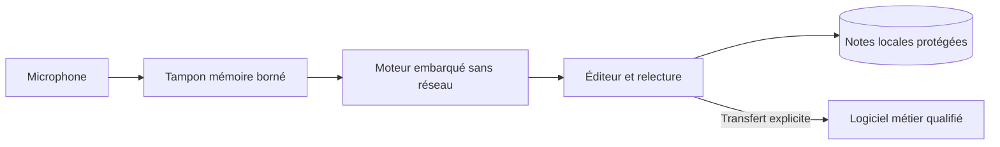

# Données et usage professionnel en France

Analyse de cadrage au 13 novembre 2026. La première phase utilise des scénarios fictifs : aucune donnée patient réelle dans les dépôts, outils de développement, tests d’agents, journaux ou démos. La destination proposée est de transcrire et mettre en forme une dictée post-consultation, pour relecture par son auteur. L’enregistrement ambiant de la consultation, la génération d’ordonnance et les recommandations médicales sont hors périmètre.

## Flux et limites du local

1. Après action explicite, le microphone alimente un tampon borné en mémoire et le moteur local. Un voyant identifie l’état de la capture. L’arrêt, la mise en veille, le verrouillage de session et la perte de périphérique interrompent la capture avec un état visible.
2. Le moteur renvoie un brouillon révisable à l’éditeur. Les segments stabilisés et les modifications manuelles alimentent un stockage local transactionnel. Le texte sauvegardé reste un brouillon avant validation du praticien. On ne conserve pas de fichier audio par défaut. Une éventuelle fonction de réécoute persistante exige une décision distincte, une finalité, un délai de suppression et le même niveau de protection que la note.
3. Le praticien relit et valide sa note avant transfert. Le stockage de NoteVive sert aux brouillons et à l’historique selon la politique du cabinet ; le logiciel métier reste la destination du dossier officiel. Une application tierce ou une sauvegarde peut avoir son propre flux réseau : le poste et la destination font partie du périmètre d’évaluation, même si NoteVive ne transmet rien.

## Mesures à prouver avant le pilote

| Risque | Mesure proposée | Preuve attendue |
| --- | --- | --- |
| Perte ou vol du poste | Répertoire de données par utilisateur, droits restreints, chiffrement du disque sur le parc pilote ; chiffrer les champs sensibles ou la base, protéger les clés avec les mécanismes Windows par utilisateur. Éviter les index en clair. Ces mesures protègent les données au repos ; une session compromise ou déjà ouverte requiert les protections du poste et de ses comptes. | Compte Windows distinct, inspection base/WAL/fichiers temporaires sur jeu fictif, récupération documentée après perte du poste. [DPAPI](https://learn.microsoft.com/en-us/windows/win32/api/dpapi/nf-dpapi-cryptprotectdata), [BitLocker](https://learn.microsoft.com/en-us/windows/security/operating-system-security/data-protection/bitlocker/configure). |
| Copie oubliée ou sauvegarde inexploitable | Stockage hors des dossiers synchronisés et des lecteurs partagés ; sauvegarde chiffrée et restauration testée sur poste de remplacement. Protection de clé distincte pour la sauvegarde : recopier des fichiers liés au compte Windows ne constitue pas une procédure de reprise. Définir la conservation des brouillons et la rotation des sauvegardes avec le cabinet. | Export/restauration sur machine de remplacement, suppression fonctionnelle de la note et inspection des répliques et rétentions ; documenter les limites d’effacement des supports et sauvegardes. |
| Fuite dans les journaux, vidages ou rapports système | Aucun texte, audio, titre de note ou contenu d’erreur brut dans les logs ; diagnostic local sans contenu ; revue des politiques de poste pour les vidages, rapports Windows, pagination et hibernation. | Recherche de marqueurs fictifs dans fichiers et logs après arrêt forcé ; revue des règles [Windows Error Reporting](https://learn.microsoft.com/en-us/windows/win32/wer/collecting-user-mode-dumps). Un tampon mémoire ne garantit pas à lui seul l’absence de traces hors processus. |
| Connexion cachée | Pas de télémétrie, d’API distante ni de téléchargement automatique en exécution. Binaire et packs de modèles signés/contrôlés et installables hors ligne. Bloquer les sorties réseau du produit sur le parc pilote ; vérifier aussi les processus enfants et les tentatives bloquées. | Installation propre hors ligne, capture réseau/processus pendant un parcours complet, aucun flux ou essai de connexion du produit ; test des mises à jour par média local. |
| Texte dans le mauvais champ | Destinations qualifiées, transfert à la demande, contrôle de la fenêtre, du champ et du contexte métier ; tout changement invalide la confirmation. Restreindre la saisie simulée à la recette fictive si le dossier n’est pas identifiable de manière fiable. En mode strict, pas de presse-papiers ni de destination dont le traitement local n’est pas établi. | Tests négatifs de changement de champ ou de dossier, fenêtres homonymes, zones masquées et contexte non identifiable ; le texte reste récupérable dans l’éditeur. Si la copie explicite est autorisée hors mode strict, vérifier les politiques d’historique et de synchronisation Windows. |
| Altération du sens | Pendant la relecture, distinguer le texte reconnu des corrections ; figer la note validée. Ne conserver un original séparé après validation que pour un besoin défini, avec délai de rétention court et accès contrôlé. Signaler les zones à vérifier sans inventer de valeurs. Aucun envoi automatique dans le dossier. | Tests de négation, valeur, unité, latéralité et ajout absent de la dictée ; une mise en forme laisse un différentiel vérifiable à la relecture. |

## Points à trancher avant les données réelles

- **RGPD et secret professionnel.** Le local ne dispense pas des obligations. Le cabinet ou l’établissement qualifie son rôle, la base du traitement et la condition applicable aux données de santé, informe les patients, documente le traitement, les accès, les durées, les droits et la gestion des incidents. Évaluer la nécessité d’une AIPD au regard du déploiement, du risque et de l’échelle ; la CNIL distingue notamment l’exercice individuel des traitements à grande échelle. [RGPD, art. 5, 9, 25, 32 et 35](https://eur-lex.europa.eu/eli/reg/2016/679/oj?locale=fr), [CNIL : professionnels de santé libéraux](https://www.cnil.fr/fr/rgpd-et-professionnels-de-sante-liberaux-ce-que-vous-devez-savoir), [guide de sécurité CNIL](https://www.cnil.fr/fr/guide-de-la-securite-des-donnees-personnelles).
- **HDS.** L’article L1111-8 vise notamment l’hébergement numérique de données de santé pour le compte d’un tiers. Installer un logiciel qui traite sur le poste du cabinet ne transforme pas à lui seul son éditeur en hébergeur. Si une sauvegarde, une infrastructure opérée par un tiers, une synchronisation ou un support avec accès est envisagé, requalifier chaque prestation, le flux réel et les obligations contractuelles avant de l’activer. [Code de la santé publique, L1111-8](https://www.legifrance.gouv.fr/codes/article_lc/LEGIARTI000033862549), [périmètre HDS selon l’ANS](https://esante.gouv.fr/faq/quel-est-le-champ-dapplication-de-la-legislation-relative-lhebergement-de-donnees-de-sante-caractere-personnel).
- **Destination réglementaire.** Documenter les fonctions et revendications exactes avec un référent compétent avant un pilote ou une diffusion clinique. La dictée documentaire est le périmètre visé ; la qualification ne découle pas de l’étiquette « outil de transcription ». Réévaluer si une fonction tire des conclusions des données, produit des informations à usage diagnostique/thérapeutique ou si la destination évolue. Vérifier aussi les obligations éventuellement applicables au titre du règlement IA, dont la formation des utilisateurs, selon les rôles et l’usage. [Règlement dispositifs médicaux, art. 2](https://eur-lex.europa.eu/eli/reg/2017/745/oj?locale=fr), [guide MDCG 2019-11 révisé](https://health.ec.europa.eu/latest-updates/update-mdcg-2019-11-rev1-qualification-and-classification-software-regulation-eu-2017745-and-2025-06-17_en), [règlement IA consolidé](https://eur-lex.europa.eu/eli/reg/2024/1689/2026-07-27/eng).
- **Revue humaine.** L’acceptation en situation simulée se fait par des praticiens. Les agents peuvent examiner le code, essayer l’interface, contrôler les écarts sur des scénarios fictifs et vérifier les preuves ; ils ne remplacent pas cette validation. Avant d’introduire des données réelles, faire acter le périmètre, les responsables, la politique du poste et le protocole d’arrêt du pilote.
