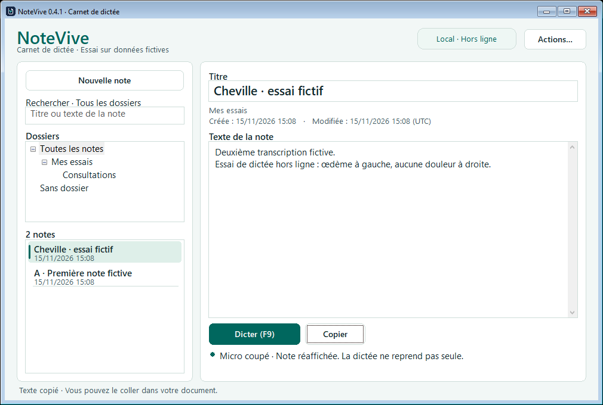

# Carnet de dictée de NoteVive 0.4.1

Capture réelle, sans retouche, de la [recette d’aperçu Windows du 15 novembre](https://github.com/sarbhakan/DocTranscript/actions/runs/43727075462/job/132851240617). Les notes sont fictives et insérées par l’automatisation, sans reconnaissance vocale. La bordure est celle de Windows Server 2022 ; son apparence dépend du système. Cette capture ne remplace pas la recette de l’EXE livré.

À gauche, **Nouvelle note** ouvre une page vide. Les dossiers et leurs sous-dossiers se trouvent au-dessus de la liste des notes. Choisissez **Toutes les notes** pour parcourir l’ensemble du carnet. Dans un dossier, la recherche porte sur les titres et le texte de ses notes et de celles de ses sous-dossiers. **Actions → Chercher dans tous les dossiers** étend la recherche à tout le carnet.

À droite, donnez un titre à la note et cliquez sur **Dicter**. Le bouton devient **Arrêter** quand le microphone s’ouvre. Après chaque pause, le résultat de la reconnaissance s’ajoute dans le texte modifiable ; le délai dépend du PC. Le panneau **Passage provisoire** n’apparaît que s’il contient du texte. Si un passage n’a pas pu être ajouté ou enregistré, relisez-le dans **Passage non enregistré** avant de quitter.

Le dossier et les dates de création et de modification (UTC) s’affichent sous le titre. La ligne du bas indique l’état de l’enregistrement local. **Copier** place le texte intégral de la note dans le presse-papiers sur demande, sans son titre. Les autres commandes sont dans **Actions** : classer la note, créer, renommer ou déplacer un dossier, trier les notes, ouvrir le vocabulaire, dicter ailleurs ou masquer la note. Le titre de la fenêtre indique la version du paquet.

| Raccourci | Action |
| --- | --- |
| `Tab` / `Maj+Tab` | Parcourir la bibliothèque, l’éditeur et les commandes |
| `F9` | Démarrer, annuler la préparation ou arrêter la dictée dans NoteVive |
| `Ctrl+N` / `Ctrl+Maj+N` | Créer une note / un dossier dans le dossier sélectionné |
| `Ctrl+F` / `Ctrl+S` | Rechercher / enregistrer la note |
| `Ctrl+Maj+C` | Copier le texte de la note |
| `Maj+F10` / `Ctrl+M` | Ouvrir Actions / masquer ou réafficher la note |
| `Ctrl+Alt+Espace` | Démarrer ou arrêter la dictée dans un champ externe compatible |

Pour la dictée externe, placez-vous dans le champ avant le raccourci. L’indicateur apparaît sans prendre le focus. Si le champ ne peut plus être vérifié, continuez dans NoteVive ou utilisez **Copier**. Word et Edge restent à qualifier sur une session Windows ordinaire ; utiliser des notes fictives pour l’essai.

La [recette Windows](../app/windows/ui_smoke.ps1) lance le paquet dans un profil vierge. Elle vérifie le parcours clavier, les zones utiles en fenêtre compacte, les dossiers et tris depuis le menu, la recherche, le masquage, l’enregistrement après relance, le glossaire et la copie Unicode. Le visuel provient d’un EXE dédié à des notes fictives. Sur un PC de recette, vérifier aussi à 1280 × 720 aux échelles 100 %, 125 % et 150 %, puis avec un thème de contraste Windows : boutons visibles, focus perceptible dans les deux sens et commandes de dictée immobiles à l’apparition d’un passage. La recette automatique ne remplace pas ces essais ni celui du microphone.
